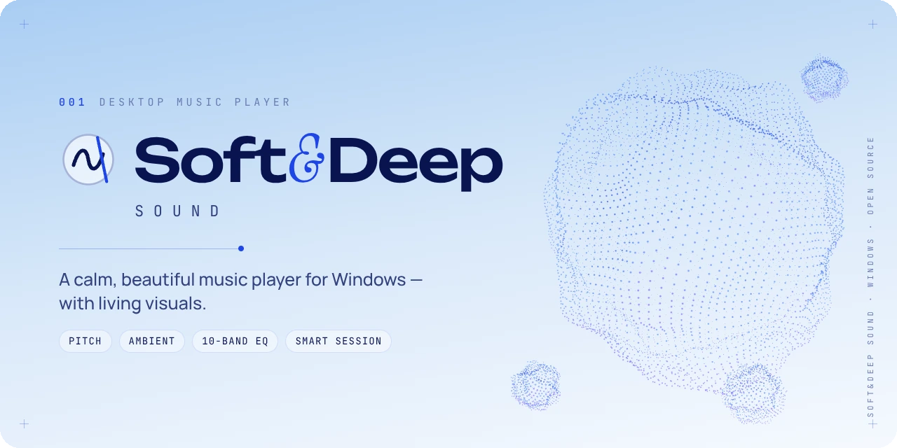
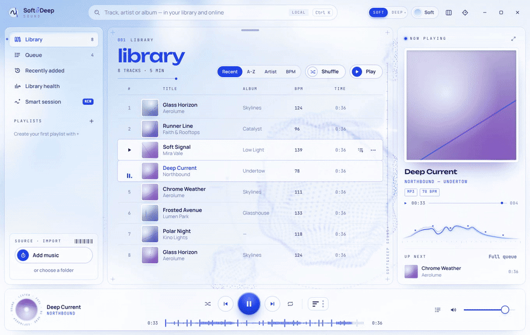
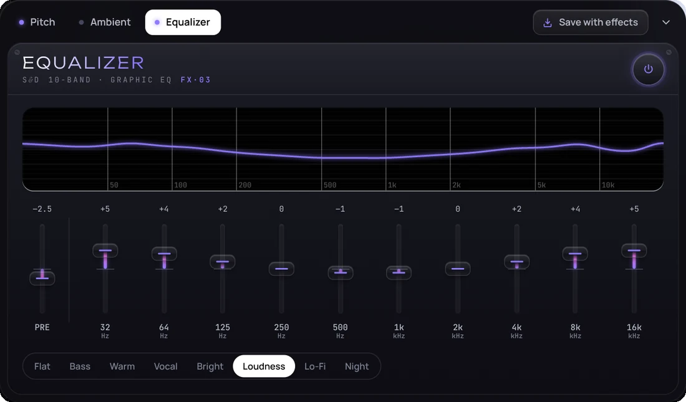
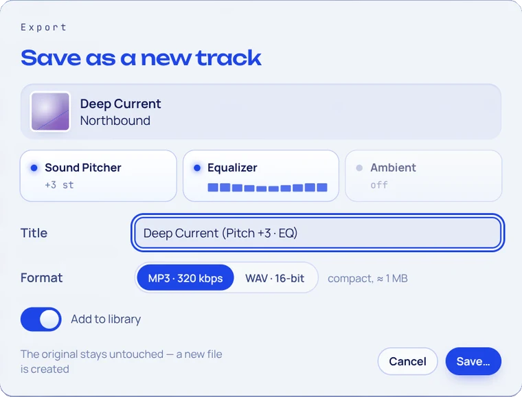
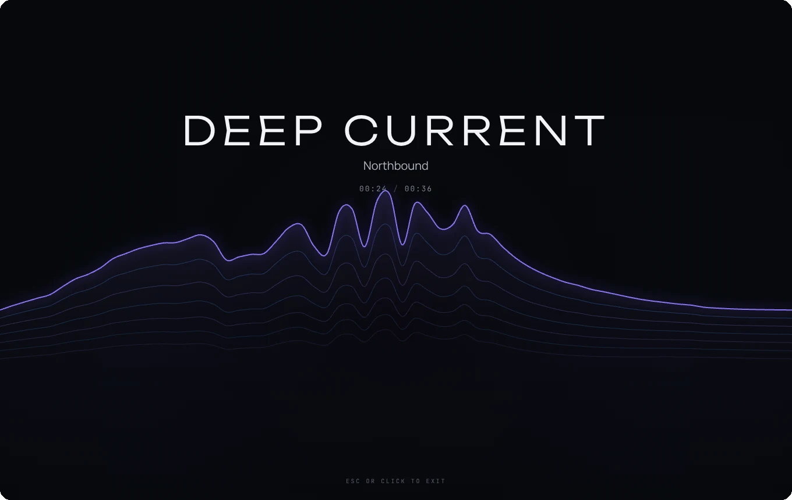
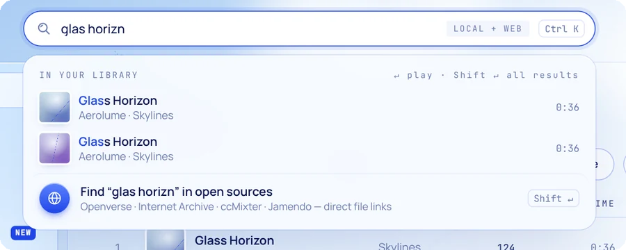

<div align="center">

<picture>
  <source media="(prefers-color-scheme: dark)" srcset="docs/media/banner-deep.webp">
  
</picture>

<br><br>

**A calm, beautiful music player for Windows.**<br>
Living 3D backgrounds that breathe with your music, plus real audio tools: pitch, ambience, EQ and export.

<br>

[](https://github.com/infallibl3/soft-deep-sound/releases/latest)
[](https://github.com/infallibl3/soft-deep-sound/releases)


[](LICENSE)

**[⬇ Download](https://github.com/infallibl3/soft-deep-sound/releases/latest)** &nbsp;·&nbsp;
[Features](#features) &nbsp;·&nbsp;
[Shortcuts](#keyboard-shortcuts) &nbsp;·&nbsp;
[Build from source](#build-from-source) &nbsp;·&nbsp;
[Русский](README.md)

<br>



</div>

<br>

## Why another music player?

Most desktop players are either **powerful but look like a spreadsheet**, or **pretty but shallow**.
Soft&Deep Sound tries to be both: something you'd happily leave open on a second monitor, with tools you'd normally need three apps for.

- 🫧 **It feels alive.** A 3D point-cloud sphere breathes slowly when it's quiet and pulses with the bass when music plays. Smaller shapes drift around it.
- 🎚 **It has real tools.** Pitch shift, ambient soundscapes that duck under vocals, a 10-band EQ, and you can save the result as a new track.
- 🔒 **It's yours.** Local files, no accounts, no ads, no telemetry.

<br>

## Two moods, four themes

**Soft** is sky, cobalt and frosted glass. **Deep** is black glass and neon. Press <kbd>D</kbd> to flip between them with a smooth circular transition.
**Pearl** and **Obsidian** are variations on the same idea. Obsidian replaces the sphere with holographic dot landscapes.

<p align="center">
  
</p>

<br>

## Features

### 🎼 Sound Pitcher
Change a song's key without changing its tempo, in semitones with fine cents. Or switch to **Vinyl** mode, where speed and pitch move together for the classic slowed / sped-up sound.

<p align="center"></p>

### 🌧 Ambient Generator + Smart Duck
Mix **rain, ocean, fireplace, train or vinyl crackle** under any track. Everything is generated in real time, so there are no loops to notice.
**Smart Duck** listens to the song and quietly lowers the ambience when vocals come in, so the voice always stays clear.

<p align="center"></p>

### 🎛 10-band Equalizer
Graphic EQ with a live curve, preamp and presets: Bass, Warm, Vocal, Bright, Loudness, Lo-Fi, Night.

<p align="center"></p>

### 💾 Save with effects
Like how it sounds? Render the pitched + EQ'd + ambient version to **MP3 (320 kbps)** or **WAV (16-bit, dithered)**, with tags kept. The new file appears in your library right away, and the original is never touched. <kbd>Ctrl</kbd>+<kbd>S</kbd>

<p align="center"></p>

### 🌌 Deep View & Visual mode
<kbd>F</kbd> opens **Deep View**, a fullscreen now-playing screen with the track's analysis: BPM, key (with Camelot), loudness (LUFS), dynamics, sound character and similar tracks from your library.
<kbd>V</kbd> dissolves the whole interface into a field of light waves.

<table>
  <tr>
    <td width="50%"></td>
    <td width="50%"></td>
  </tr>
  <tr>
    <td align="center"><sub>Deep View</sub></td>
    <td align="center"><sub>Visual mode</sub></td>
  </tr>
</table>

### ✨ Smart Session
Pick a mood (Calm, Deep, Energetic or Dark), a length and a tempo range, and get a ready-made queue. It avoids recent repeats and too many songs by one artist in a row. Save it as a playlist with one click.

<p align="center"></p>

### 📥 Playlist import
Bring a playlist over from **Deezer** (by link), **Spotify** (sign in to your account through the official API) or a **CSV / TXT / M3U** file. Files cover Yandex Music, VK, Apple Music and other services: export the playlist with Soundiiz or TuneMyMusic.
Only track names are transferred: the player finds them among your files, copes with transliteration and typos, and keeps remixes apart from originals. Doubtful matches can be checked by hand. The playlist remembers missing tracks and fills itself in when you add the files.

<details>
<summary>Connecting Spotify</summary>

1. Open the [Spotify developer dashboard](https://developer.spotify.com/dashboard) and create an app (free).
2. Add `http://127.0.0.1:43117/callback` under **Redirect URIs** and tick **Web API**.
3. Paste the **Client ID** into “Import playlist → My Spotify” and press “Sign in with Spotify”.

Spotify’s rules for apps in development mode: the owner needs Premium, up to 5 people can sign in (add them under User Management), and only your own and collaborative playlists expose their tracks. Other people’s playlists come over via a file.
</details>

### 🧭 Built-in tour
On first launch a short tour lights up the main controls and explains what they do. Replay it with the **?** button in the title bar.

### 🔎 Search that forgives you
Typos, transliteration (`kino` finds «Кино»), even typing in the wrong keyboard layout (`ьфвщттф` → `madonna`).
<kbd>Enter</kbd> plays the best match instantly. <kbd>Shift</kbd>+<kbd>Enter</kbd> also searches open music sources: Openverse, Internet Archive, ccMixter and Jamendo. You can also paste a link to any page and the player will find the audio files on it.

<p align="center"></p>

### 🩺 Library Health
Finds broken Cyrillic tags (mojibake like `Ïðèâåò`) and fixes them, plus duplicates, missing covers and tags, lost files and low-quality copies.

<p align="center"></p>

### And also
- **Background play in the tray.** Closing the window keeps the music going. The tray menu has play/pause, next/previous, volume and a **sleep timer** (15–90 min or end of track, with a soft fade-out).
- **Windows integration:** taskbar thumbnail buttons, media keys, optional start with Windows.
- **Drag & drop** files and folders, playlists, custom covers, editable track info (your files are never modified).
- **Flexible layout:** drag panels, resize them, hide what you don't need.
- **English and Russian** interface.

<br>

## Download

1. Open **[Releases](https://github.com/infallibl3/soft-deep-sound/releases/latest)**.
2. Download one of:
   - `SoftDeepSound-Setup-x.y.z.exe`: an installer with a desktop shortcut;
   - `SoftDeepSound-Portable-x.y.z.exe`: a single file, no install needed.

> [!NOTE]
> The app isn't code-signed (certificates are expensive for a hobby project), so Windows SmartScreen may say *"Windows protected your PC"*.
> Click **More info → Run anyway**, or [build it yourself](#build-from-source) from the source code.

<br>

## Keyboard shortcuts

| Key | Action | Key | Action |
|---|---|---|---|
| <kbd>Space</kbd> | Play / pause | <kbd>Ctrl</kbd>+<kbd>K</kbd> | Search |
| <kbd>←</kbd> <kbd>→</kbd> | Seek ±5 s (<kbd>Shift</kbd> ±15 s) | <kbd>Ctrl</kbd>+<kbd>←</kbd> <kbd>→</kbd> | Previous / next track |
| <kbd>↑</kbd> <kbd>↓</kbd> | Volume | <kbd>M</kbd> | Mute |
| <kbd>S</kbd> | Shuffle | <kbd>R</kbd> | Repeat |
| <kbd>P</kbd> <kbd>A</kbd> <kbd>E</kbd> | Pitch / Ambient / Equalizer | <kbd>Ctrl</kbd>+<kbd>S</kbd> | Save with effects |
| <kbd>F</kbd> | Deep View | <kbd>V</kbd> | Visual mode |
| <kbd>D</kbd> | Soft ↔ Deep | <kbd>Esc</kbd> | Close panel |

Knobs and faders: drag, scroll the mouse wheel, or double-click to reset.

<br>

## Build from source

You need [Node.js](https://nodejs.org) 20 or newer.

```bash
git clone https://github.com/infallibl3/soft-deep-sound.git
cd soft-deep-sound
npm install
npm start          # run in development
npm run dist       # build the installer and portable .exe into dist/
```

On Windows you can also just double-click **`BUILD-EXE.bat`**: it installs Node.js if needed and builds everything.
Every tag like `v1.9.0` is built automatically by GitHub Actions and published to Releases.

<br>

<details>
<summary><b>🛠 Under the hood</b></summary>
<br>

| Part | How it works |
|---|---|
| App | Electron with plain HTML, CSS and JavaScript, no frameworks. `contextIsolation`, sandbox, a custom `sds://` protocol for local files |
| Background | WebGL point clouds displaced by 3D simplex noise in the vertex shader, lit with rim and specular light. Quality adapts to the frame rate, and rendering pauses when the window is hidden |
| Pitch | A custom `AudioWorklet` pitch shifter, so the tempo stays the same |
| Ambience | Procedural sound generators, plus a vocal-band detector that drives Smart Duck |
| Analysis | BPM, key, LUFS and waveform peaks in a Web Worker |
| Export | The whole effect chain is replayed in an `OfflineAudioContext`. WAV gets TPDF dither; MP3 is encoded with lamejs in a Worker |
| Search | Damerau–Levenshtein distance, Cyrillic↔Latin transliteration, keyboard-layout swap and field weighting |
| Online | Open-licence sources only; downloads go through SSRF-safe fetching (manual redirects, public-IP checks) |

More detail in [ARCHITECTURE.md](ARCHITECTURE.md).

</details>

<details>
<summary><b>📁 Project structure</b></summary>
<br>

```
main.js                   window, tray, sds:// protocol, IPC, tags & covers
preload.js                narrow bridge to the renderer
src/search/               open-source music search and safe downloads
renderer/
  index.html, styles.css  layout and design system
  themes-sd.css           Soft / Deep tone styles
  js/app.js               library, playlists, queue, views
  js/audio-engine.js      Web Audio graph
  js/pitch-worklet.js     key shift (AudioWorklet)
  js/ambient.js           procedural ambience + Smart Duck
  js/shapes.js            WebGL sphere and dot landscapes
  js/exporter.js          offline render, WAV/MP3 encoding
  js/fuzzy.js             typo-tolerant local search
  js/deepview.js          fullscreen now-playing
```

Your library lives in `%APPDATA%/Soft&Deep Sound/library.json`.

</details>

<br>

## Credits

- MP3 encoding: [lamejs](https://github.com/zhuker/lamejs) (LGPL-3.0)
- Fonts: [Unbounded](https://fonts.google.com/specimen/Unbounded), Manrope, JetBrains Mono, Instrument Serif (SIL Open Font License)
- Open music sources: Openverse, Internet Archive, ccMixter, Jamendo

Made by **Konstantin** as a personal project, with a lot of help from an AI assistant.
Bug reports and ideas are very welcome in [Issues](https://github.com/infallibl3/soft-deep-sound/issues).

<div align="center">
<br>

If you like it, a ⭐ helps other people find the project.

</div>
