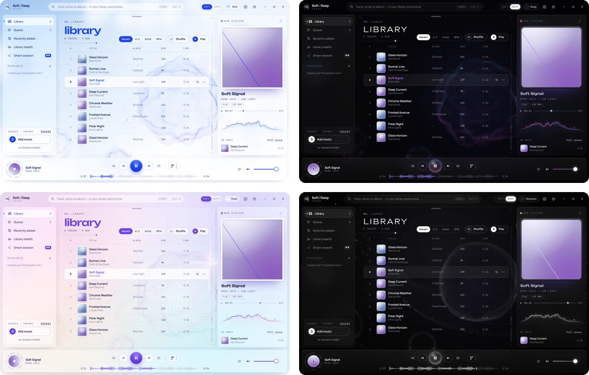
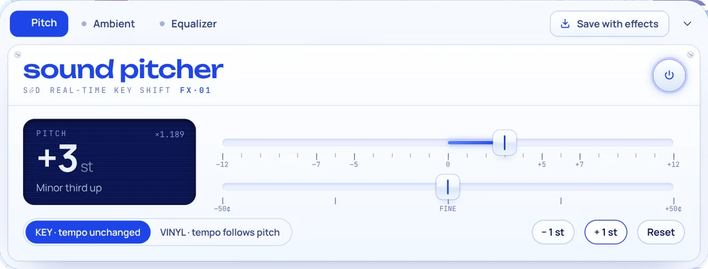
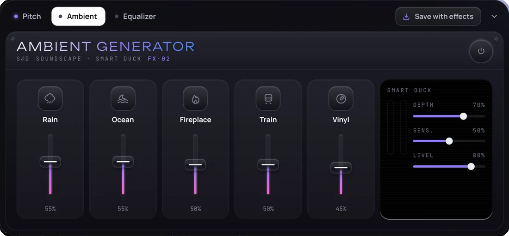
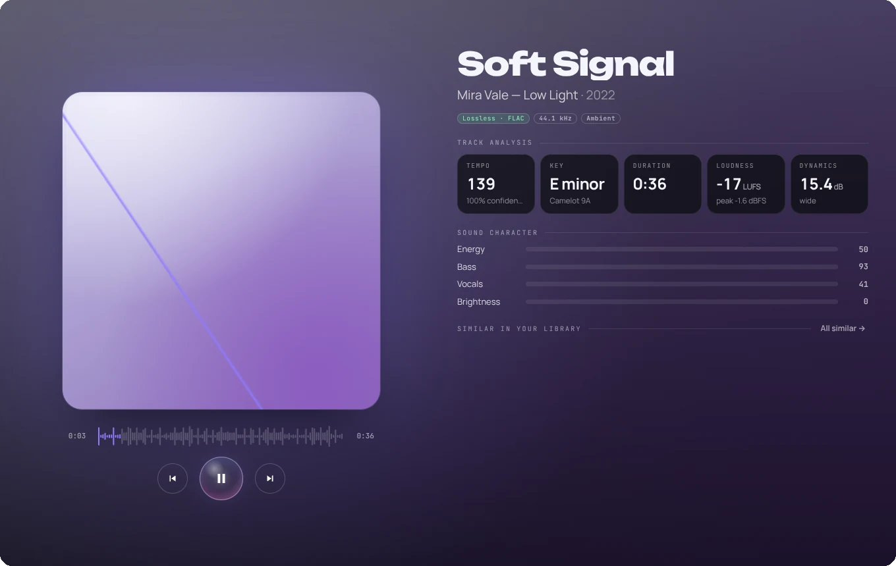
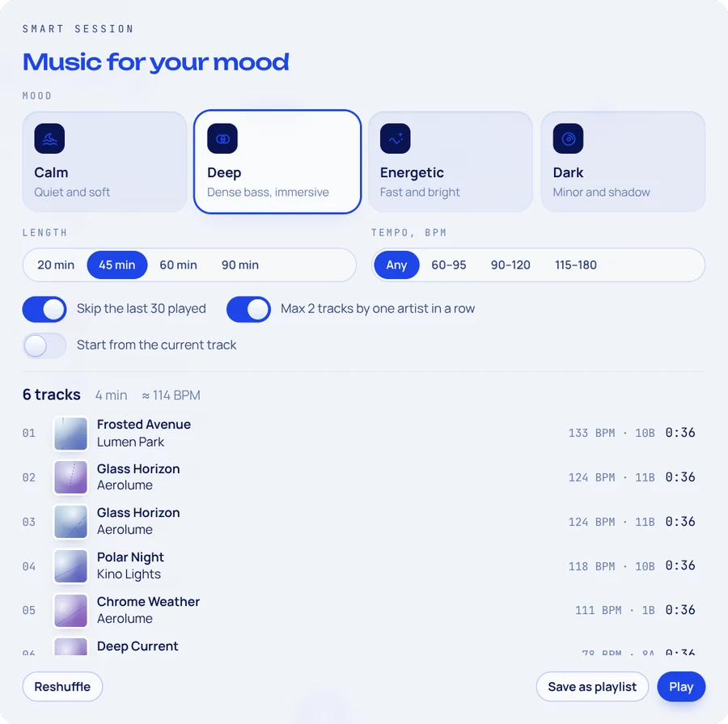
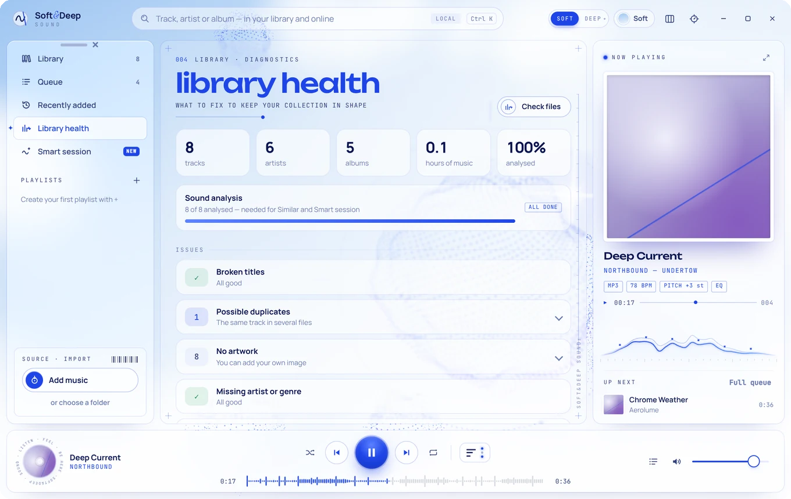

<div align="center">

<picture>
  <source media="(prefers-color-scheme: dark)" srcset="docs/media/banner-deep.webp">
  
</picture>

<br><br>

**Спокойный и красивый музыкальный плеер для Windows.**<br>
Живой 3D-фон, который дышит вместе с музыкой, и настоящие аудиоинструменты: тональность, эмбиент, эквалайзер и экспорт.

<br>

[](https://github.com/avdeevkosta00-ship-it/soft-deep-sound/releases/latest)
[](https://github.com/avdeevkosta00-ship-it/soft-deep-sound/releases)

[](LICENSE)

**[⬇ Скачать](https://github.com/avdeevkosta00-ship-it/soft-deep-sound/releases/latest)** &nbsp;·&nbsp;
[Возможности](#возможности) &nbsp;·&nbsp;
[Горячие клавиши](#горячие-клавиши) &nbsp;·&nbsp;
[Сборка](#сборка-из-исходников) &nbsp;·&nbsp;
[English](README.md)

<br>


</div>

<br>

## Зачем ещё один плеер?

Большинство плееров либо **мощные, но выглядят как таблица**, либо **красивые, но пустые**.
Soft&Deep Sound пытается совместить и то и другое: его приятно держать открытым на втором мониторе, и в нём есть инструменты, для которых обычно нужны три разные программы.

- 🫧 **Он живой.** Сфера из тысяч точек медленно дышит в тишине и пульсирует в такт басу, когда играет музыка. Вокруг неё плавают фигуры поменьше.
- 🎚 **В нём есть настоящие инструменты.** Сдвиг тональности, эмбиент, который сам затихает под вокалом, 10-полосный эквалайзер. Результат можно сохранить как новый трек.
- 🔒 **Он ваш.** Локальные файлы, без аккаунтов, рекламы и телеметрии.

<br>

## Два настроения, четыре темы

**Soft**: небо, кобальт, матовое стекло. **Deep**: чёрное стекло и неон. Клавиша <kbd>D</kbd> переключает их с плавным круговым переходом.
**Pearl** и **Obsidian** развивают ту же идею. В Obsidian вместо сферы на фоне голографические пейзажи из точек.

<p align="center">
  
</p>

<br>

## Возможности

### 🎼 Sound Pitcher
Меняет тональность песни без изменения темпа, по полутонам с точной подстройкой в центах. Режим **Vinyl** меняет скорость и высоту вместе, как у пластинки.

<p align="center"></p>

### 🌧 Ambient Generator + Smart Duck
**Дождь, океан, камин, поезд или треск винила** под любым треком. Звуки генерируются на лету, поэтому повторяющихся петель не слышно.
**Smart Duck** слушает песню и тихо убавляет эмбиент, когда вступает голос.

<p align="center"></p>

### 🎛 10-полосный эквалайзер
Графический эквалайзер с живой кривой, предусилением и пресетами.

<p align="center"></p>

### 💾 Сохранить с эффектами
Понравился звук? Сохраните версию с Pitch, эквалайзером и эмбиентом в **MP3 320 kbps** или **WAV 16 бит**, теги сохранятся. Новый файл сразу появится в медиатеке, оригинал не меняется. <kbd>Ctrl</kbd>+<kbd>S</kbd>

<p align="center"></p>

### 🌌 Погружение и визуализация
<kbd>F</kbd> открывает полноэкранный режим с анализом трека: BPM, тональность (с кодом Camelot), громкость LUFS, динамика, характер звучания и похожие треки из медиатеки.
<kbd>V</kbd> растворяет интерфейс в поле световых волн.

<table>
  <tr>
    <td width="50%"></td>
    <td width="50%"></td>
  </tr>
</table>

### ✨ Умная сессия
Выберите настроение, длительность и темп и получите готовую очередь без недавних повторов. Её можно сохранить как плейлист одной кнопкой.

<p align="center"></p>

### 🔎 Поиск, который прощает ошибки
Находит треки с опечатками, по транслиту («kino» найдёт «Кино») и даже при неправильной раскладке («ьфвщттф» → «madonna»).
<kbd>Enter</kbd> сразу включает лучший трек, <kbd>Shift</kbd>+<kbd>Enter</kbd> ищет ещё и в открытых источниках. Можно вставить ссылку на страницу: плеер найдёт на ней аудиофайлы.

<p align="center"></p>

### 🩺 Состояние медиатеки
Находит и исправляет битые названия (кракозябры вроде `Ïðèâåò`). Показывает дубликаты, треки без обложек и тегов, пропавшие файлы и копии низкого качества.

<p align="center"></p>

### А ещё
- **Работа в трее.** Если закрыть окно, музыка продолжит играть. В меню трея есть управление, громкость и **таймер сна** с плавным затуханием.
- Кнопки на панели задач, мультимедийные клавиши, автозапуск вместе с Windows.
- Перетаскивание файлов и папок, плейлисты, свои обложки. Данные трека правятся только в плеере, сами файлы не трогаются.
- Перестраиваемые панели, русский и английский интерфейс.

<br>

## Скачать

1. Откройте **[Releases](https://github.com/avdeevkosta00-ship-it/soft-deep-sound/releases/latest)**.
2. Скачайте нужный файл:
   - `SoftDeepSound-Setup-x.y.z.exe`: установщик, создаёт ярлык на рабочем столе;
   - `SoftDeepSound-Portable-x.y.z.exe`: один файл, работает без установки.

> [!NOTE]
> У программы нет платной цифровой подписи, поэтому Windows может показать «Система Windows защитила ваш компьютер».
> Нажмите **«Подробнее» → «Выполнить в любом случае»**.

<br>

## Горячие клавиши

| Клавиша | Действие | Клавиша | Действие |
|---|---|---|---|
| <kbd>Space</kbd> | Пуск / пауза | <kbd>Ctrl</kbd>+<kbd>K</kbd> | Поиск |
| <kbd>←</kbd> <kbd>→</kbd> | ±5 с (<kbd>Shift</kbd> ±15 с) | <kbd>Ctrl</kbd>+<kbd>←</kbd> <kbd>→</kbd> | Предыдущий / следующий трек |
| <kbd>↑</kbd> <kbd>↓</kbd> | Громкость | <kbd>M</kbd> | Без звука |
| <kbd>S</kbd> | Перемешать | <kbd>R</kbd> | Повтор |
| <kbd>P</kbd> <kbd>A</kbd> <kbd>E</kbd> | Pitch / Ambient / Эквалайзер | <kbd>Ctrl</kbd>+<kbd>S</kbd> | Сохранить с эффектами |
| <kbd>F</kbd> | Погружение | <kbd>V</kbd> | Визуализация |
| <kbd>D</kbd> | Soft ↔ Deep | <kbd>Esc</kbd> | Закрыть панель |

Ручки и фейдеры можно тянуть мышью или крутить колесом. Двойной клик сбрасывает значение.

<br>

## Сборка из исходников

Нужен [Node.js](https://nodejs.org) версии 20 или новее.

```bash
git clone https://github.com/avdeevkosta00-ship-it/soft-deep-sound.git
cd soft-deep-sound
npm install
npm start          # запуск для разработки
npm run dist       # сборка установщика и portable .exe в папку dist/
```

Или дважды щёлкните **`BUILD-EXE.bat`**: скрипт сам поставит Node.js и всё соберёт.
Каждый тег вида `v1.9.0` автоматически собирается через GitHub Actions и публикуется в Releases.

Как всё устроено внутри, описано в [ARCHITECTURE.md](ARCHITECTURE.md) и в разделе «Under the hood» [английского README](README.md).

<br>

## Благодарности

- Кодирование MP3: [lamejs](https://github.com/zhuker/lamejs) (LGPL-3.0)
- Шрифты Unbounded, Manrope, JetBrains Mono, Instrument Serif (SIL Open Font License)
- Открытые источники музыки: Openverse, Internet Archive, ccMixter, Jamendo

Автор **Константин**. Это личный проект, сделанный с большой помощью ИИ-ассистента.
Идеи и баги пишите в [Issues](https://github.com/avdeevkosta00-ship-it/soft-deep-sound/issues).

<div align="center">
<br>

Если плеер понравился, поставьте ⭐: так проект увидит больше людей.

</div>
